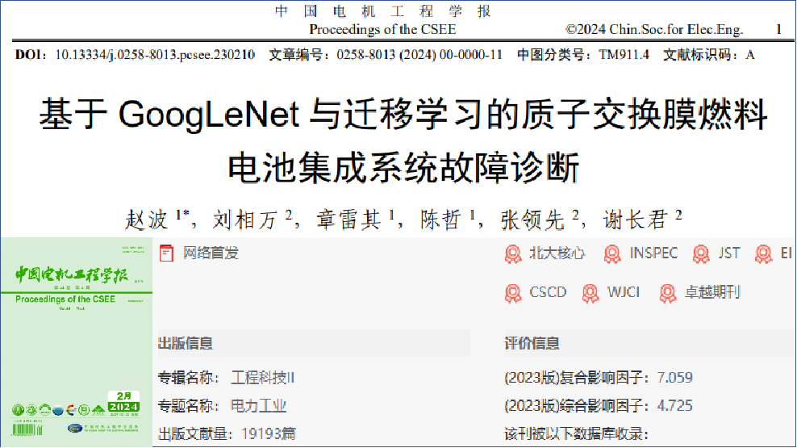
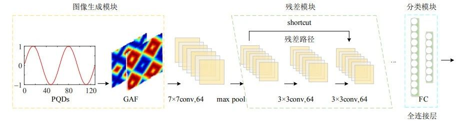
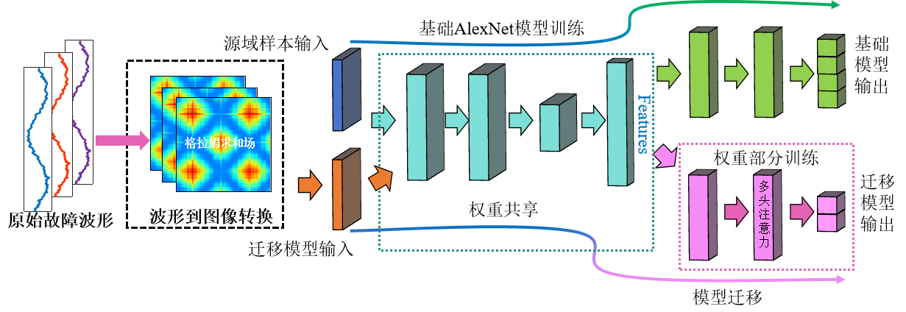
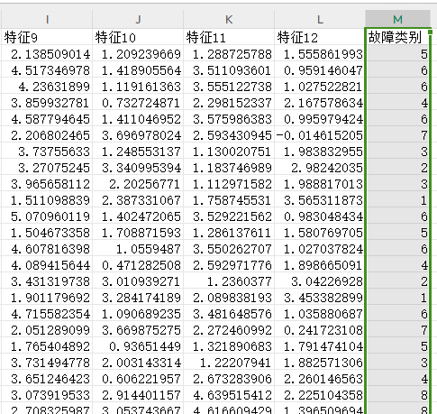
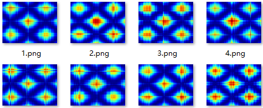
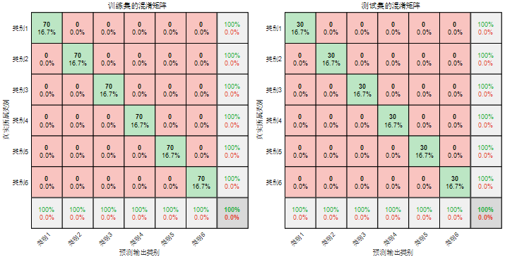
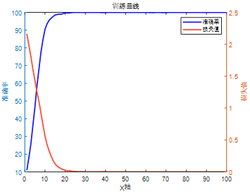

# Transfer Learning! Ultra-Innovative! GASF-AlexNet-MSA, a Fault Identification Program Based on Grammar Corner and AlexNet with a Multi-Head Attention Mechanism

Applicable Platform: Matlab 2023 version and above.
Reference: Chinese top-tier EI journal "Journal of China Electric Power Engineering" published online on February 29, 2024, titled "Fault Diagnosis of Proton Exchange Membrane Fuel Cell Integrated System Based on GoogleNet and Transfer Learning": This article was just added to the CNKI a few days ago. It is evident that transfer learning can serve as a major innovation point across various research directions. With the updates of more large-scale networks, transfer learning also brings endless possibilities for your paper.
Document 1: Job Interpretation:
① Objective Modeling: Firstly, establish the fuel cell integrated system simulation model.
② Data Collection: Output features data of five states, namely normal (Category 1), cooling system failure (Category 2), hydrogen supply system failure (Category 3), air supply system failure (Category 4), and flooding failure (Category 6) by changing the parameters of various components in the integrated system.
③ Pre-trained Model: Transfer learning is used to extract and save the parameters of the feature extraction part of the pre-trained model into GoogLeNet.
④ Model Transfer: Modify the parameters of the fully connected layer and output layer, and train the fault feature images.
Model Testing: Utilize the trained GoogLeNet model to classify 2000 sets of fault feature images. Comparatively analyze the proposed method with other deep learning methods, verifying the classification accuracy and robustness of the proposed method.
Document 2 Interpretation: The innovation of this document lies in the integration of Gram-Schmidt Algorithm (GADF) and Convolutional Neural Networks (CNN) to achieve fault classification. GADF converts one-dimensional signals into two-dimensional feature maps, while CNN can perform adaptive feature extraction and classification on these feature maps. Through experimental research, this method has higher classification detection accuracy and adaptability. We have improved the CNN mentioned in the above file into AlexNet and combined it with multi-head attention mechanism!
GASF-AlexNet-SMA Transfer Learning Fault Identification Program
What is transfer learning?
Transfer learning is the process of applying learned knowledge or skills to new contexts or tasks. Imagine you have learned to drive and then you need to learn to ride a motorcycle, although they are not exactly the same, some of your previous skills (like observing traffic rules, controlling speed) can help you when learning to ride a motorcycle. In the field of computer science, transfer learning is using previously learned knowledge, such as patterns or features learned from one task, to help solve a new related task instead of starting from scratch. This can save time and resources and sometimes achieve better results on the new task.

6 major innovation points:
1. Time-series visualization: Converting one-dimensional time series signals into two-dimensional images to more comprehensively describe data characteristics. This helps extract richer and more discriminative features, thereby improving classification and recognition accuracy.
2. Spatial feature learning: AlexNet performs excellently in image processing, effectively learning spatial features and local patterns of images. Using AlexNet for image data processing can help extract texture, shape, and edge features of images, which is beneficial for more accurate classification and fault identification.
3. Transfer learning: Fully utilizing the pre-trained AlexNet model on large datasets, standing on the shoulders of giants, drawing on the strengths of many others, and through transfer learning, fine-tuning the model for fault identification tasks, it has strong feature extraction capabilities.
4. Fewer training times: Focusing on training the weight of the model's fine-tuning part, maintaining low computational complexity, is conducive to application in real-time scenarios.
5. Multi-head self attention mechanism: Integrating the multi-head attention mechanism (MSA) effectively grasps the contribution degree of extracted features, focusing on strengthening features to improve fault identification accuracy.
6. Enhancing generalization ability: Multimodal fusion helps algorithms better understand the essential features of data, thereby reducing the risk of overfitting and enhancing the algorithm's generalization ability on new data.
Applicable Fields: Suitable for various data classification scenarios, such as rolling bearing faults, transformer oil and gas faults, power system transmission line fault areas, insulators, distribution networks, and disturbances to power quality. It is used for identification, diagnosis, and classification in these fields.
Data Format: Each row represents a sample, with the last column being the fault type label of the sample.
\nProgram Results: (The above one-dimensional sequence is automatically converted into a Gram plot by the program)
Program Results:

## Images

<!-- PAYMENT_BLOCK -->

## Get this dataset

- Payment link (Stripe): [Buy now](https://buy.stripe.com/3cs8yP7sY87d0vu9AB)
- Payment QR code: 

<!-- /PAYMENT_BLOCK -->
